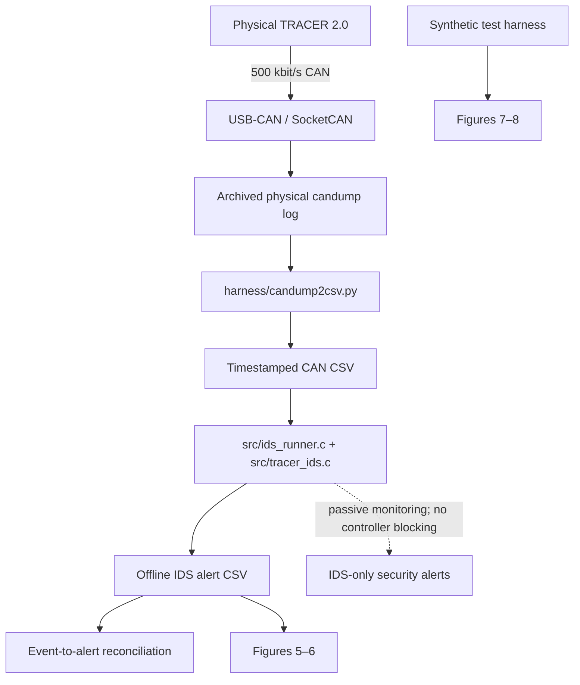
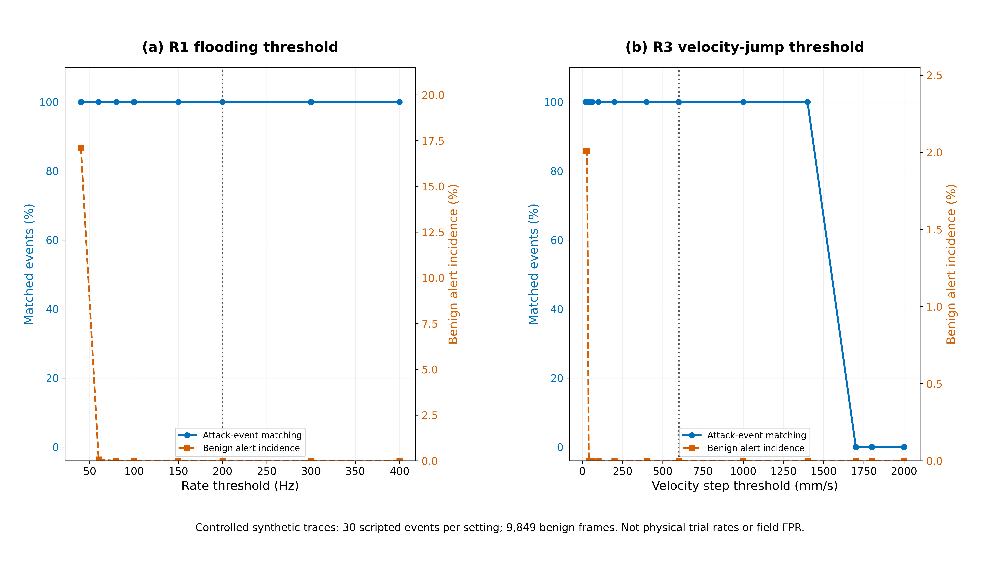
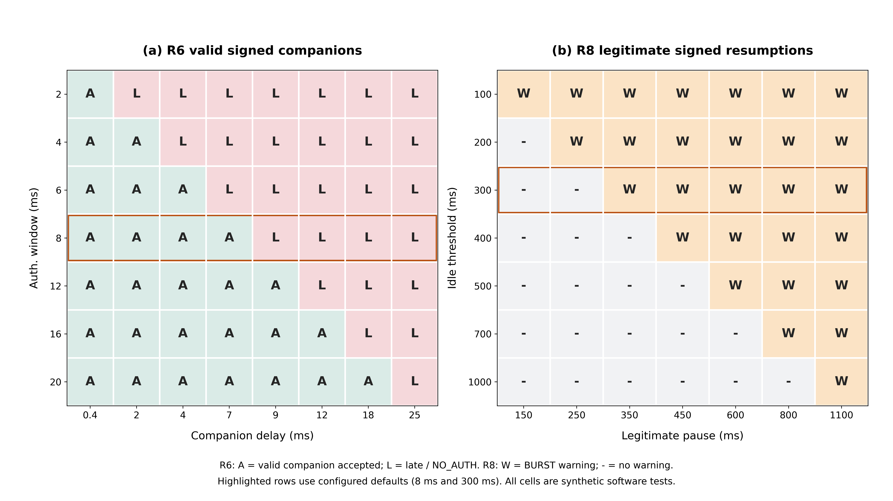

# TRACER 2.0 CAN Security — Reproducible Physical Evidence and Offline IDS Evaluation

[](#reproduce-the-results)
[](#experimental-platform)
[](LICENSE)

**Source code, archived physical CAN traffic, offline intrusion-detection results, and reproducibility scripts** accompanying the revised manuscript:

> **Experimental CAN Security Evaluation of a Commercial Unmanned Ground Vehicle with Intrusion Detection and Authentication Monitoring**  
> Journal of Systems Architecture, manuscript **JSA-D-26-01018** (revision artifact; publication status should be confirmed independently).  
> Mahmoud Ahmed Khalifa, Ahmad Taher Azar, and Walid El-Shafai.

**Read this distinction first:** the original CAN traffic was collected from a **physical AgileX TRACER 2.0**. The alerts and event-to-alert matches presented here were subsequently **reconstructed offline** by processing the archived capture with the C IDS. The repository does **not** demonstrate real-time IDS latency, prevention by the unmodified robot controller, or detection reliability across independent campaigns.

## Contents

- [Experimental platform](#experimental-platform)
- [Architecture and data flow](#architecture-and-data-flow)
- [Physical scenarios and verified findings](#physical-scenarios-and-verified-findings)
- [Archived results](#archived-results)
- [Repository structure](#repository-structure)
- [Reproduce the results](#reproduce-the-results)
- [Regenerate publication figures](#regenerate-publication-figures)
- [Evidence provenance and limitations](#evidence-provenance-and-limitations)
- [Responsible research and disclosure](#responsible-research-and-disclosure)
- [AI use, citation, and license](#ai-use-citation-and-license)

## Experimental platform

- **Physical system:** AgileX Robotics TRACER 2.0 unmanned ground vehicle (UGV).
- **Bus:** manufacturer-documented classical CAN at **500 kbit/s**.
- **Acquisition:** a Linux SocketCAN-compatible USB–CAN adapter; preserved log in [`data/live_capture/exp_live_session.log`](data/live_capture/exp_live_session.log).
- **Detection:** specification-aware, passive C IDS with a 14-identifier whitelist, traffic-rate and plausibility checks, and selective companion-frame HMAC-SHA-256 monitoring.
- **Protected command types monitored:** motion command `0x111`, mode selection `0x421`, error clearing `0x441`; `0x112` is the research-specific HMAC companion frame, *not* a native TRACER manufacturer command.
- **Critical architectural boundary:** the original TRACER controller does **not** verify this research HMAC. The IDS reports suspicious commands but cannot block their execution.

## Architecture and data flow



All reproduction commands below operate on the archived capture or synthetic tests. **They do not transmit CAN frames to a robot.**

## Physical scenarios and verified findings

| Scenario | Test condition | Evaluated occurrences | Supported observation |
|---|---|---:|---|
| A1 | Unauthenticated motion command | 30 | Offline `NO_AUTH` matching |
| A2 | Unauthenticated mode-control request | 30 | Offline `NO_AUTH` matching; no demonstrated forced mode transition |
| A4 | Five-second high-rate CAN command session | 1 session | `FLOOD` matching; **no demonstrated controller DoS** |
| A5 | **Crafted valid-MAC stale-sequence injection** | 30 | Offline `STALE_SEQ` matching; **not physical literal replay** |
| A6 | Invalid HMAC companions | 30 | Authentication-failure matching |
| A7 | Abrupt velocity-command changes | 30 | `VEL_JUMP` matching; physical acceleration not quantified |
| A8 | Repeated invalid-MAC attempts | 30 | Repeated-failure / `BRUTE_FORCE` matching |
| A9 | Unknown CAN identifiers | 30 | `UNKNOWN_ID` matching |
| **Total** | **One physical acquisition campaign** | **211** | **211/211 event-to-alert matches after offline processing** |

No separately validated physical **A3** phase is part of this archive. The 211 scripted occurrences are **not 211 independent robotic trials**.

## Archived results

| Quantity | Archived value | Evidence |
|---|---:|---|
| Physical CAN frames | **34,419** | [`exp_live_session.log`](data/live_capture/exp_live_session.log) |
| Reconstructed offline alert records | **5,453** | [`archived_strict_frames_al.csv`](results/archived_strict_frames_al.csv) |
| Scripted occurrences with matching alerts | **211/211** | [`archived_claims_reconciled.json`](results/archived_claims_reconciled.json) |
| A5 stale-sequence occurrences with matching alerts | **30/30** | Reconciliation report and recorded `STALE_SEQ` alerts |
| Frames outside designated attack windows | **10,414** | Reconciliation report |
| Alerts on those excluded-window frames | **0** | Not a validated deployment false-positive rate |
| C regression tests | **8 passed** | `make -B` / `src/test_v3.c` |
| Targeted Python tests | **7 passed** | `harness/test_dlc_parity.py`, `harness/test_fasttrack.py` |

### Offline IDS alert types

| Type | Alert records |
|---|---:|
| `NO_AUTH` | 5,011 |
| `BRUTE_FORCE` | 212 |
| `VEL_JUMP` | 60 |
| `BAD_MAC` | 58 |
| `FLOOD` | 49 |
| `STALE_SEQ` | 30 |
| `UNKNOWN_ID` | 30 |
| `BURST` | 3 |
| **Total** | **5,453** |

**Alert records are not independent attacks.** In particular, the single A4 flooding session contributes thousands of records. The high event-matching fraction is a result for the **tested scripted conditions in this capture**, not a generalizable detection-probability estimate.

## Repository structure

```text
.
├── README.md                  # this research and reproduction guide
├── AI_USAGE.md                # AI-assisted work disclosure
├── LICENSE                    # software license; verify data release rights separately
├── Makefile                   # builds C tools and runs 8 C tests
├── requirements.txt           # Python dependencies for offline analysis
├── .github/workflows/         # optional automated offline validation
├── src/                       # IDS, runner, HMAC implementation, C tests
├── harness/                   # capture converter, synthetic tests, sweeps
├── scripts/                   # evidence verification and reconciliation
├── data/live_capture/         # preserved physical CAN capture
├── results/                   # archived frames, alerts, metrics, diagnostics
├── publication/               # evidence traceability and figures 5–8
├── docs/                      # additional methodology and guidance
└── historical/                # prior material, if approved for public release
```

**Source priority:** `src/` and `harness/` contain executable source. Files under `bin/` are historical compiled outputs and should not be used as evidence of a fresh build. Source should be rebuilt on the reader's machine.

## Reproduce the results

Tested command structure: Ubuntu/Linux, GCC, Python 3; Python 3.12 is a supported reproduction target, **not a claim about the original host**.

### 1. Prepare Ubuntu

```bash
sudo apt update
sudo apt install -y build-essential git python3 python3-venv
python3 -m venv .venv
source .venv/bin/activate
python -m pip install -r requirements.txt
```

### 2. Build from source and run tests

```bash
make -B  # deliberately rebuilds all executables; also runs 8 C tests
PYTHONPATH=harness python -m pytest -q harness/test_dlc_parity.py harness/test_fasttrack.py
```

**Why `-B`?** Original ZIP archives may contain precompiled `bin/` files without executable permissions or with misleading timestamps. Rebuilding avoids running those files by mistake.

### 3. Verify the physical capture and replay it offline

```bash
sha256sum data/live_capture/exp_live_session.log
# Expected: 5f7e2ca1ef2e55904fa1d68899dc65a5b65f27763f30254f282b22d8a8f46094

python3 scripts/verify_publication_evidence.py
python3 scripts/reconcile_archived_capture.py
```

The replay verification checks the capture, regenerates CAN frame/alert records in a **temporary directory**, and compares alert categories against the archived summary. The reconciliation also preserves the original A5 strict-audit finding instead of converting it to a false PASS.

### 4. Repeat the synthetic threshold studies

```bash
python3 harness/sweep.py
python3 harness/sweep_validated.py
python3 publication/render_figures_7_8.py --check-only
```

These commands regenerate **software-derived** R1/R3 and R6/R8 diagnostics. They do **not** create additional physical robot experiments.

## Regenerate publication figures

| Figure | Interpretation | Source | Command |
|---|---|---|---|
| **5** | Offline alert timeline | `results/archived_strict_frames_al.csv` | `python3 publication/render_figures_5_6.py` |
| **6** | Offline alert category distribution | Same archived alert CSV | Same command |
| **7** | R1/R3 sensitivity (software tests) | `results/sweeps.json` | `python3 publication/render_figures_7_8.py` |
| **8** | R6/R8 sensitivity (software tests) | `results/validated_threshold_diagnostics.json` | Same command |


*Figure 5: one-second bins from the archived capture. This is **not** a measurement of online alert latency.*


*Figure 6: exact alert-record counts, not counts of independent attack occurrences.*





> **Figure 9 was removed from the current publication scope.** The archived HMAC summary is historical material and is not presented as independently reproducible raw timing data. Do not run the legacy `publication/render_figures_7_9.py` to regenerate publication figures: it creates a now-excluded Figure 9. The new scripts above generate Figures 5–8 only.

## Evidence provenance and limitations

1. **Original capture:** one archived session from one physical TRACER 2.0; file integrity can be checked against the archived SHA-256 but independent capture provenance is not established by a checksum alone.
2. **Offline results:** alerts were reconstructed by the C IDS from archived timestamps. No online alert-delay, embedded gateway throughput, or physical command blocking measurement is claimed.
3. **A5:** physical data show crafted valid-MAC stale-sequence injections, with 30 matched `STALE_SEQ` occurrences. The original `results/archived_strict_audit.json` reports `FAIL` **only against the stronger historical expectation of byte-for-byte authenticated-pair replay**. The source evidence and that finding remain preserved. Literal authenticated-pair replay was studied separately in software.
4. **A4:** a five-second high-rate session produced `FLOOD` alerts; the capture does not establish command starvation or successful denial of service.
5. **False positives:** 0 alerts among 10,414 frames outside designated attack windows is a specific exclusion-window observation, not an operational false-positive rate.
6. **HMAC:** the archived 200,000-iteration host benchmark records summary statistics without raw per-call samples or a verified CPU identity. It is **not** a Figure 9 result for the current paper and must not be represented as an embedded timing measurement.
7. **Experimental keys:** the implementation contains a fixed laboratory HMAC key for testing. It is not production key management and must not be reused as an operational secret.

Additional sources: [`publication/EVIDENCE_TRACEABILITY.md`](publication/EVIDENCE_TRACEABILITY.md), [`publication/PROVENANCE_LIMITATIONS.md`](publication/PROVENANCE_LIMITATIONS.md), [`results/archived_claims_reconciled.md`](results/archived_claims_reconciled.md).

## Responsible research and disclosure

This repository supports authorized academic reproducibility and defensive CAN protocol analysis. Commands that transmit to an actual vehicle must **not** be run without permission, a controlled test environment, hardware safety procedures, and an accessible emergency stop. The offline instructions above never require connecting to a live vehicle.

Publication of recorded CAN traffic, hardware photographs, correspondence, and laboratory-owned code should be approved by the relevant rights holders. The MIT text in [`LICENSE`](LICENSE) covers software to the extent its copyright owner has approved that grant; data reuse may require separate permission.

## AI use, citation, and license

- **AI-assisted documentation:** See [`AI_USAGE.md`](AI_USAGE.md). The disclosure is a draft to be reviewed and finalized by the human authors before journal submission.
- **Citation:** Please cite the associated paper using its final bibliographic metadata once published. Until then, cite the manuscript title, authors, revision identifier `JSA-D-26-01018`, and this repository's commit hash. A commit hash makes the referenced artifact immutable.
- **License:** [`LICENSE`](LICENSE) (MIT software-license text in the supplied archive, subject to rights-holder authorization).

**Maintained research artifact:** [`M-khalifa1/Tracer-can-analysis`](https://github.com/M-khalifa1/Tracer-can-analysis). Please open an issue for a reproducibility discrepancy; include the OS/Python/GCC versions, command, exit code, and a sanitized error log (never tokens or secrets).
